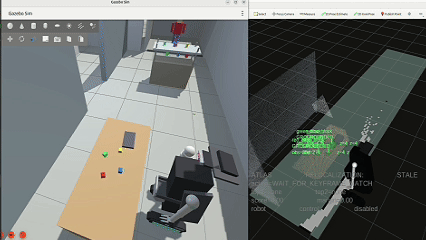
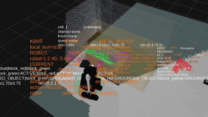
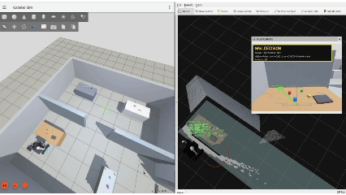

# KRVF-Atlas with FFbot

**A ROS 2 robot world model for embodied AI, VLA, semantic voxel memory, and language-guided mobile manipulation.**

[](https://doi.org/10.5281/zenodo.21225319)


KRVF-Atlas connects VLM/VLA reasoning with robot execution through a source-aware semantic voxel world. It grounds language and image-space detections into RGB-D + TF-backed 3D evidence, stores objects and grasp candidates in KRVF, and uses Atlas action cells for spatial memory, place context, and SLAM-like localization advice.

The system is currently **not open-source**. Public release is planned **after September 2026**.

**Links:** [Technical Report](https://doi.org/10.5281/zenodo.21225319) · [Demo Video](https://www.bilibili.com/video/BV1KXM56kE1X/)

## What it does

- Builds a queryable robot world model from RGB-D, TF, and semantic observations.
- Grounds VLM/VLA outputs into 3D voxel evidence.
- Stores objects, aliases, freshness, hypotheses, and grasp candidates in KRVF.
- Uses Atlas action cells and keyframes for spatial memory and place context.
- Routes known objects from memory to Nav2 and MoveIt 2.
- Searches for unknown targets with VLM, then grounds and grasps them.
- Keeps high-level AI away from direct actuator authority.

## Demo highlights

### VLA Force-Grasp

*See it. Pull it. Strike it.*

<p align="center">
  
</p>

### Atlas Memory Pick

*Known objects, routed and grasped across rooms.*

<p align="center">
  
</p>

### Atlas Action Cells

*Voxel landmarks recover place context.*

<p align="center">
  
</p>

### Zero-Prior VLM Hunt

*No YOLO. No prior map. Find, ground, grasp.*

<p align="center">
  
</p>

## Runtime idea

```text
language task
-> Atlas query or VLM search
-> RGB-D / TF grounding
-> KRVF semantic voxel update
-> Nav2 approach
-> observation refresh
-> grasp validation
-> MoveIt 2 execution
```

KRVF-Atlas separates:

```text
semantic proposal != grounded world evidence != action authorization
```

That separation is the point: the VLM can propose, but the runtime decides whether the robot is allowed to move or grasp.

## Why it matters

Embodied AI needs more than recognition. A robot must remember what was seen, where it was grounded, whether it is still fresh, and whether it can support action. KRVF-Atlas turns VLM cognition into robot-usable world state.

## What questions this project explores

- How can VLM/VLA outputs become grounded robot world state?
- How can a mobile manipulator use semantic voxel memory for language-guided grasping?
- How can robot actions be gated by source, freshness, grounding, and geometric support?
- How can a robot search for an unknown object without YOLO or a prior object map?
- How can action cells provide SLAM-like spatial context for embodied AI systems?

## System stack

- **ROS 2 Jazzy**
- **Gazebo + RViz**
- **KRVF semantic voxel world**
- **Atlas action cells / keyframes / object aliases**
- **Nav2** for mobile navigation
- **MoveIt 2** for arm execution
- **VLM/VLA planner** for language and visual search

## Keywords

Embodied AI, Vision-Language-Action, VLA, VLM, robot world model, semantic voxel mapping, semantic voxel memory, spatial memory, mobile manipulation, language-guided robotics, RGB-D grounding, ROS 2, Nav2, MoveIt 2, Gazebo, RViz.

## Author

**Runfeng Ling**
