# KRVF：Keyframe-Reprojected Visual Voxel Field

[](https://docs.ros.org/)


**Languages:** [English](README.md) | [中文](README_CN.md)

**DEMO:** [YouTube](https://www.youtube.com/watch?v=GmTiUTxT-PY) | [Bilibili](https://www.bilibili.com/video/BV1QA5H6DEam/)

> 一种面向机器人行动的、带来源感知的**语义体素世界**。

> 一种机器人表达感知感受世界的方法

> 一个有限算力下的相对高性能的实时建图方法。

KRVF 是一个面向边缘移动操作机器人的语义体素世界表示框架。它不是另一个点云可视化工具，也不是简单的 `OctoMap + YOLO` 拼接。它想解决的是一个更贴近机器人行动的问题：

**机器人看到世界之后，应该如何记住它、解释它、查询它，并在传感器失败时仍然知道该对哪里下手？**

传统建图系统通常把目标放在几何重建：地图越完整、表面越平滑、误差越小越好。KRVF 的目标不同。它面向移动抓取场景，把地图重新组织成一个可查询、可解释、带来源和时效性的任务状态场。

简单说，KRVF 给机器人提供的不是一张“看起来很像世界”的地图，但它又确实有点像“Minecraft 我的世界”：机器人眼前的环境被变成一个可以被行为树、抓取模块和任务系统直接消费的机器人世界表示。

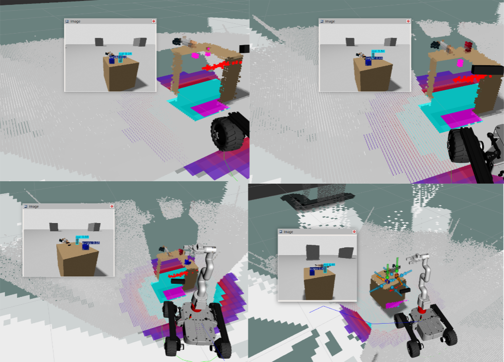

---

## 技术报告

技术报告把 KRVF 定位为一种面向边缘移动操作的、带来源感知的语义体素世界表示。

报告主要内容包括：

- KRVF world representation
- source-aware voxel state
- observed-hypothesis separation
- map-prior and depth-failure handling
- task-level object and grasp queries
- decoupled ROS 2 integration

相关文件：

- [`KRVF_TECHNICAL_REPORT_DRAFT.pdf`](docs/KRVF_TECHNICAL_REPORT_DRAFT.pdf)

如果读者感兴趣可以看这篇文章，未来会做相关论文工作。
---

## KRVF 做了什么

KRVF 从 RGB-D 相机、TF/pose、语义检测和深度修复模块中融合信息，构建一个稀疏语义体素场。每个体素不只记录 `occupied / free`，还记录：

- 占据概率的 log-odds
- 颜色和外观状态
- 语义标签与置信度
- 时间新鲜度
- 证据来源
- observed / repaired / hypothesis / uncertain 等状态

这意味着机器人不只是知道“这里有东西”，还知道：

- 这个东西是深度相机真的看见的，还是语义先验推断出来的？
- 这个观测是不是刚刚发生的，还是旧残影？
- 这个区域是否可以作为抓取候选？
- 这个目标能不能被行为树或 manipulation pipeline 直接查询？

KRVF 也不依赖 RGB 纹理完成几何建图。只要深度有效，它就能在低光、弱纹理环境中持续构建 3D voxel map。在这里，RGB 更像是锦上添花的颜色和语义增强通道。

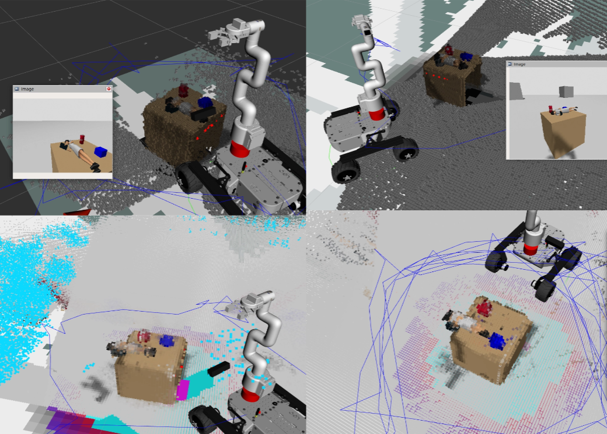
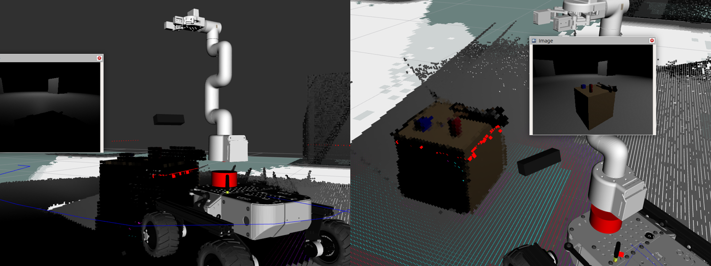
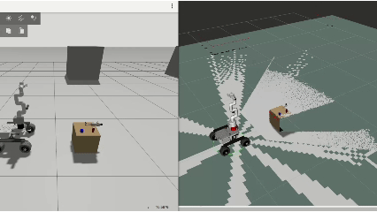
---

## 和传统点云 / RTAB-Map Cloud 有什么区别

传统点云和 RTAB-Map 这类系统非常有价值。它们擅长做 RGB-D SLAM、相机位姿估计、回环、地图拼接和场景点云重建。换句话说，它们更着重于：

```text
我在哪里？
我看过哪些地方？
这些观测能不能拼成一张几何地图？
```

KRVF 关心的是另一个问题：

```text
机器人现在能对什么东西采取行动？
这个目标可靠吗？
它是观测到的，修复出来的，还是语义假设出来的？
它还能不能被抓？
行为树能不能直接查询它？
```

点云通常是“几何观测的集合”。它可以很真实、很密，但下游模块还要自己从点云里找对象、判断新旧、处理语义、生成抓取候选。KRVF 则把点云背后的空间组织成体素世界状态，让每个体素带有来源、语义、时间和任务意义。

所以 KRVF 并不是要替代 RTAB-Map。更合理的关系是：

- RTAB-Map / SLAM 可以提供位姿和全局地图背景。
- PointCloud2 可以提供原始几何观测。
- KRVF 把这些观测整理成机器人可以查询和行动的语义体素世界。

如果说 RTAB-Map 更像机器人的“空间记忆”，那么 KRVF 更像机器人的“任务工作台”：它不只是保存世界，还把世界整理成可以被抓取、查询、等待和更新的状态。

但是确实长得和点云挺像的....
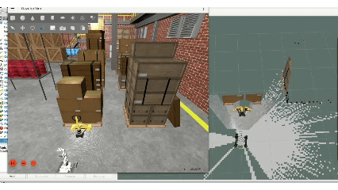
---

## 核心思想

KRVF 的核心思想是：

> 机器人不应该只重建几何。它应该维护一个带来源、可查询、能支撑行动的世界状态。

在透明、反光、高光、深色或薄物体上，RGB-D 深度经常失效。传统 occupancy mapping 可能会把目标区域当成 free space 挖掉。KRVF 不把这种情况粗暴地合并进普通几何地图，而是维护显式的 observed / hypothesis 分离：

- **Observed layer**：由真实深度和可靠观测维护的几何占据。
- **Hypothesis layer**：在深度失败但语义证据存在时生成的任务假设。
- **Query layer**：给机器人提供 object query 和 grasp query。

这个设计让机器人可以在深度失败时仍然保留一个“可以去做手脚”的抓取候选，同时不污染持久几何地图。

我相信在后续开发中，KRVF 还可以发展出更好的深度失效区域恢复方法。目前我尝试了用 YOLO 语义进行深度恢复，以及在深度失效区域进行方块覆盖式恢复，都有一定效果，特别是对机械臂的泛顶抓有帮助。

当然还有很多可以探索的地方，比如三维导航等等。

---

## 像 Minecraft，但给机器人用

KRVF 的可视化很像 Minecraft，这也算是它的灵感来源之一。换句话说，机器人并不一定需要一个无限精细、无限平滑的世界。对很多操作任务来说，方块世界已经足够机器人理解眼前环境。

也许未来某一天，当机器人真的开始“感受世界”时，它们反而会更喜欢这种方块化、可操作、可查询的世界表达。

方块化体素世界提供了一种非常直接的机器人世界表达：离散、可查询、可更新、可擦除，也天然适合被上层任务系统消费。

在这个意义上，KRVF 把机器人看到的 RGB-D 世界变成了一个可以被程序操作的 block world：

- 观测到的几何可以变成稳定方块。
- 深度失败的区域可以生成显式假设方块。
- 旧物体残影可以被动态清除。
- 语义目标可以被查询。
- 抓取候选可以从体素结构中生成。
- 行为树和 manipulation pipeline 可以通过 ROS 接口接入。
- 后续还可以继续开发更多玩法。

这也是 KRVF 为什么要解耦设计的地方：mapper 只维护世界状态，不写死机器人玩法。后续开发者可以在这个世界表示上继续接导航、抓取、搜索、交互、任务规划、VLM policy 或新的行为树逻辑。

换句话说，KRVF 给机器人提供一个“创造模式”的底层世界：

**地图不再只是地图，而是机器人行为可以继续生长的可编程世界基座。**

<p align="center">
  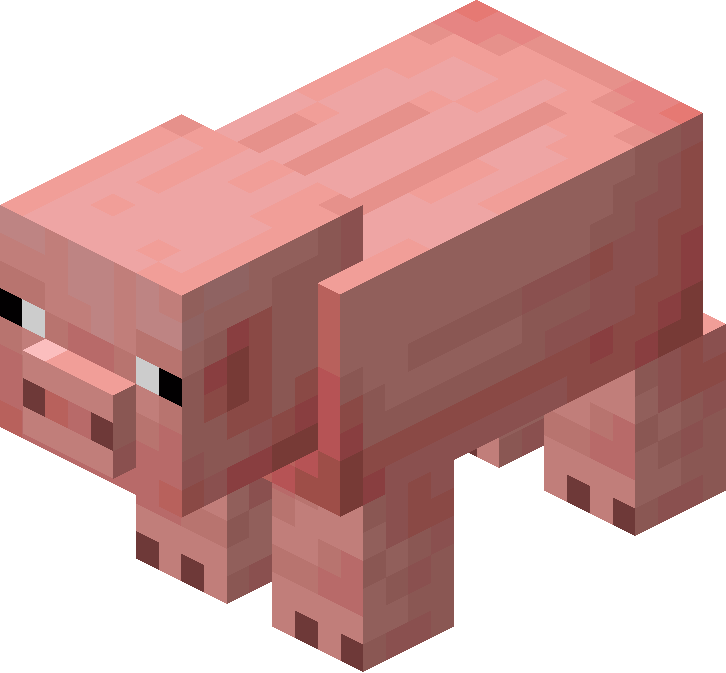
  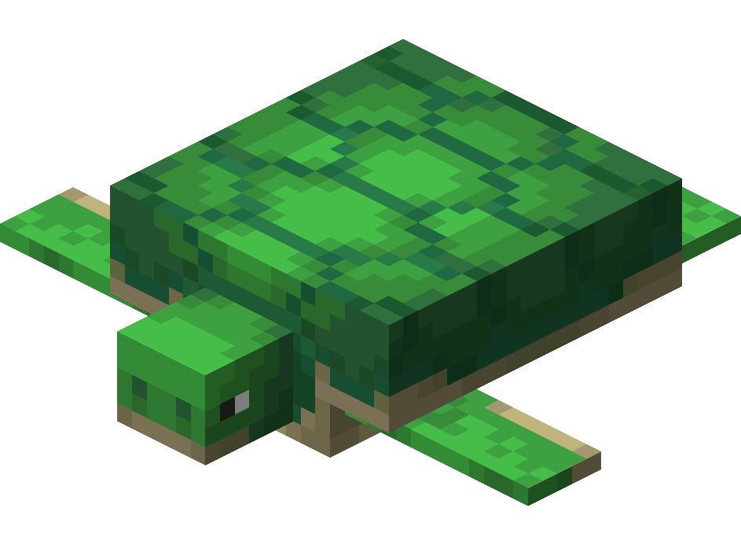
</p>

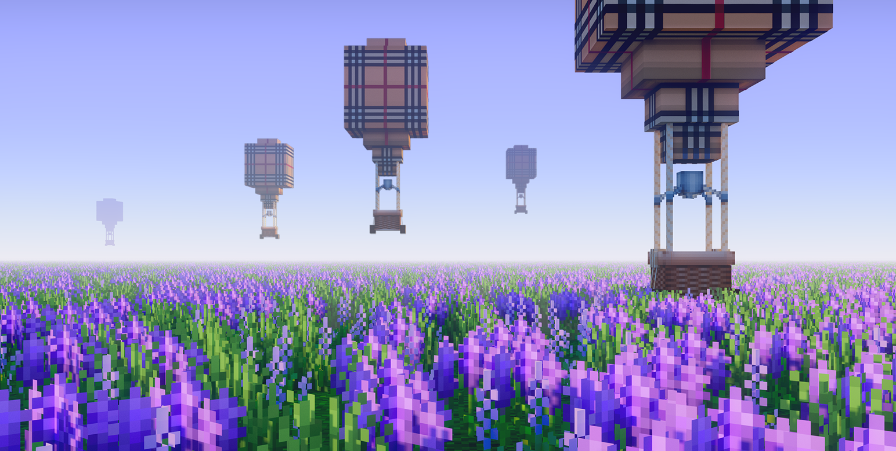

---

## 主要特性

### 带来源感知的语义体素

KRVF voxel 不只是一个占据格子，而是一个任务状态单元：

```text
voxel = 占据状态 + 颜色 + 语义证据 + 置信度 + 时间新鲜度 + 来源类型
```

这让地图能表达“为什么相信这里有东西”，而不是只表达“这里有没有东西”。

### 观测层与假设层分离

KRVF 把真实观测和语义假设分开维护。语义可以帮助机器人在深度失败时形成抓取候选，但不会默认改写真实几何地图。

这是 KRVF 最重要的设计之一：

**语义先验可以支持行动，但不应该悄悄污染真实观测地图。**

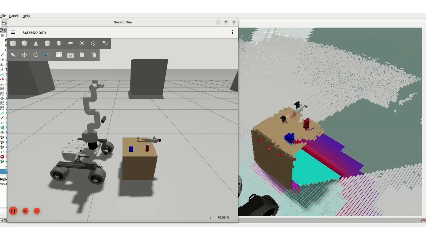

### 面向深度失效的语义补全

对于故意构造的深度失效区域、手动删除 YOLO 检测框内深度、透明或反光物体深度缺失等情况，KRVF 可以生成显式 semantic hypothesis，并把它作为可查询的任务目标。

它把“我没有看见，但我有语义证据认为这里可能有目标”作为一种明确状态暴露出来，而不是把它伪装成普通几何。

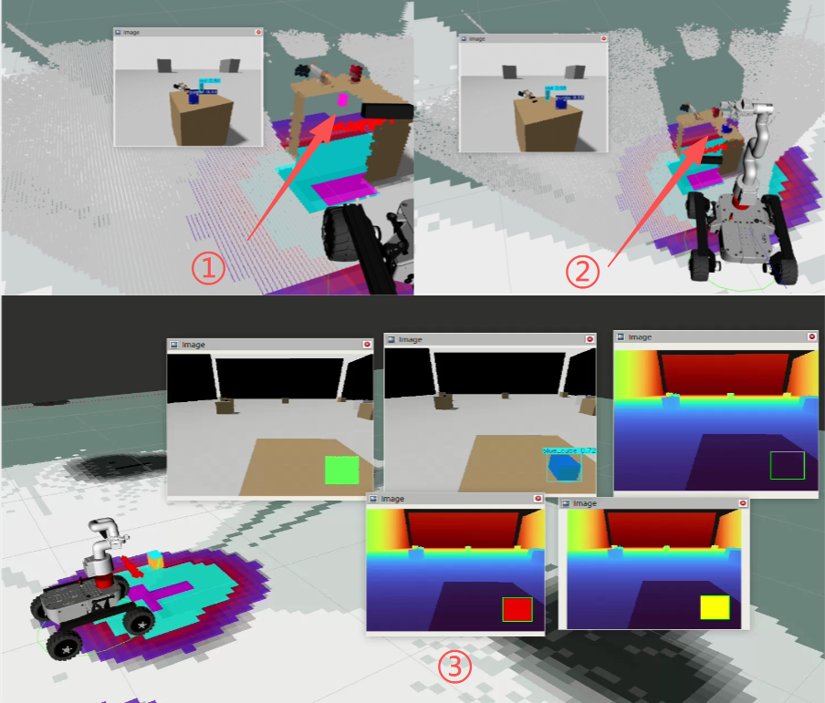
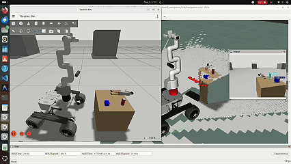

### 任务级对象与抓取查询

KRVF 不要求下游模块自己解析点云。它直接暴露：

- 语义对象查询
- 抓取候选查询
- 等待对象出现的 action
- 抓取候选可视化 marker
- 对象位姿 bridge

机器人可以问：

```text
红色方块在哪里？
它是否足够稳定？
给我抓取候选。
等到目标出现再继续。
```

所以它就能干很多事情。

KRVF 更像是一个机器人记忆服务器，而不是一个被动地图发布器

这里展示一个小demo，它可以根据方块群的姿态赋予其合适的抓取位姿，为每个抓取姿势打分判断最佳抓取姿势。

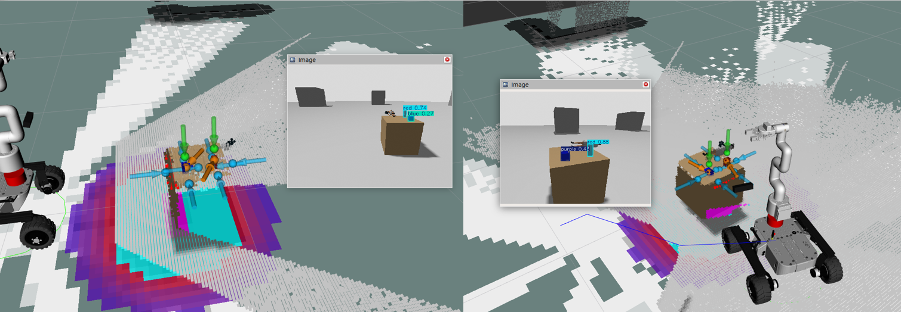
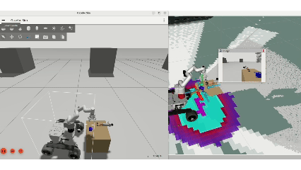
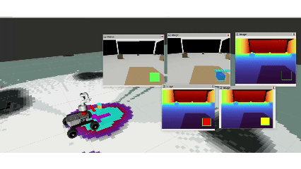

### 解耦的 ROS 2 集成

KRVF 的 mapping core 不绑定具体机器人、机械臂、YOLO 模型、MoveIt pipeline 或 behavior tree。

只要机器人提供：

- RGB-D 图像
- 相机标定
- TF / pose transform
- ROS 2 topic / service / action 接口

就可以接入同一个 KRVF world model。机器人相关逻辑通过 bridge node 接入，而不是写死在 mapper 里。

---

## 系统架构

```text
RGB-D 相机 + TF/Pose
        |
        v
KRVF 稀疏体素建图核心
        |
        +--> observed voxel layer
        +--> free-space evidence
        +--> semantic hypothesis layer
        +--> map-prior depth
        |
        v
任务级查询接口
        |
        +--> /krvf_cpp/query_object
        +--> /krvf_cpp/query_grasp_candidates
        +--> /krvf_cpp/wait_for_object
        |
        v
行为树 / 抓取 Bridge / Manipulation Stack
```
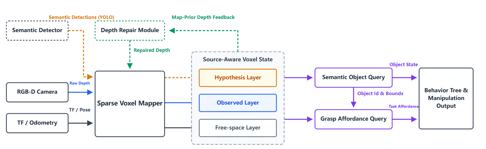
KRVF 位于感知和行动之间。  
它把 RGB-D 观测变成机器人真正能使用的世界状态。

---

## 仓库状态

这个仓库目前是 KRVF 的项目归档、demo 记录和技术报告配套仓库。

当前状态：

- 已实现 ROS 2 版本的 KRVF 建图模块。
- 已实现 C++ 体素建图核心。
- 包含 Python prototype / reference modules。
- 已实现语义 bridge 和 hypothesis update 路径。
- 已实现对象查询和抓取候选查询服务。
- 已录制深度失效和语义补全 demo。
- 已准备 arXiv 技术报告草稿用于时间戳留档。

第一版公开会比较保守。部分代码、脚本和 launch 文件还在清理、整理和补文档。

**计划在 2026 年 9 月完全开源。**

---

## 开发环境与边缘算力说明

KRVF 的开发和 demo 主要运行在一台普通轻薄本/迷你主机级别的设备上，而不是高端工作站：

- 操作系统：Ubuntu 24.04.2 LTS
- 内核版本：6.17
- CPU：13 代 Intel Core i5-1335U
- 内存：16 GB RAM
- GPU：Intel UHD Graphics 核显
- NVIDIA 独显：无

也就是说，当前演示并不是建立在高端 NVIDIA GPU 工作站上的。KRVF 的建图核心主要依赖 CPU 上的 C++ 实现，目标就是在边缘移动机器人常见的算力条件下，提供实时、可查询、可解释的语义体素世界状态。

当然，这里不把当前 demo 夸成严格性能 benchmark。更严谨的 latency、CPU 占用、内存占用和不同硬件平台对比，会放到后续技术报告或论文实验里继续补。

但是如此可爱小巧的电脑都能跑大地图建图，也算是某种证明吧。

---

**当前公开技术报告不声称已经完成真机抓取实验。真机验证会作为后续工作继续推进。**


## KRVF 不是什么

KRVF 不是：

- 完整 SLAM 后端
- RTAB-Map、Nav2 或 MoveIt 的替代品
- photorealistic neural scene representation
- 通用最优抓取规划器
- 已完成真机闭环验证的系统

KRVF 是一个表示层：它把在线感知组织成一个带来源、可查询、面向任务的机器人世界状态。

---

## 总结

**KRVF 是一种让机器人记住自己看见了什么，标记自己推断了什么，忘掉已经移动的东西，并查询下一步可以对什么采取行动的建图方法**
