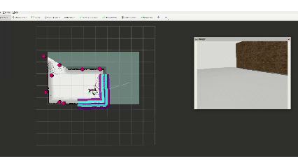

# Team 8 Course Submission

## Summary

This folder is a reduced ROS 2 workspace prepared for coursework submission. It contains the Phase 1 simulation and integration chain used for:

- rover simulation startup
- SLAM and navigation bringup
- map-based patrol / exploration entry points
- vision-topic integration for object detection
- rover-arm grasp workflow packaging

The submission copy keeps the package structure and launch context needed for review, while removing or simplifying nonessential demos and detailed implementation variants.

## Included Function Areas

### 1. Mobile Base

- `slam_toolbox / cartographer` mapping support
- `Nav2` localization and navigation launch support
- simulated rover spawn, map loading, and RViz monitoring
- patrol / exploration-side entry scripts

Main package:

- `src/team8_navigation`

### 2. Mobile Manipulation

- detection-topic integration during patrol / exploration
- `YOLO + RGB-D + TF` handoff structure for grasp-side topics
- `myCobot + MoveIt2 + MTC` launch-side integration
- basic package structure for rover-arm coordination

Main packages:

- `src/team8_yolov8`
- `src/mycobot_mtc_pick_place_demo`
- `src/mycobot_moveit_config`
- `src/mycobot_interfaces`

### 3. Supporting Package

- `src/team8_trajectory_server`

## Expected Workspace Layout

```text
Team-8-AERO62520-Robotic-Systems-Design-Project/
├── README.md
├── SUBMISSION_SCOPE.md
└── src/
    ├── mycobot_interfaces/
    ├── mycobot_moveit_config/
    ├── mycobot_mtc_pick_place_demo/
    ├── team8_navigation/
    ├── team8_trajectory_server/
    └── team8_yolov8/
```

This folder is intended to be used as the workspace root for `colcon build`.

## How To Build

```bash
source /opt/ros/jazzy/setup.bash
cd ~/Team-8-AERO62520-Robotic-Systems-Design-Project
colcon build
source install/setup.bash
```

If required by the local environment, model files or other external runtime assets should be placed separately and configured through launch arguments or environment variables.

## Representative Startup Flow

```bash
# Terminal 1
ros2 launch mycobot_mtc_pick_place_demo mtc_grasp_leorover.launch.py world:=simplytest.sdf

# Terminal 2
ros2 launch team8_navigation navigation_with_slam.launch.py

# Terminal 3
ros2 launch team8_navigation yolo_sim.launch.py

# Terminal 4
ros2 run team8_yolov8 yolo_to_grasp_node

# Terminal 5
ros2 run team8_navigation explore_and_patrol.py
```


